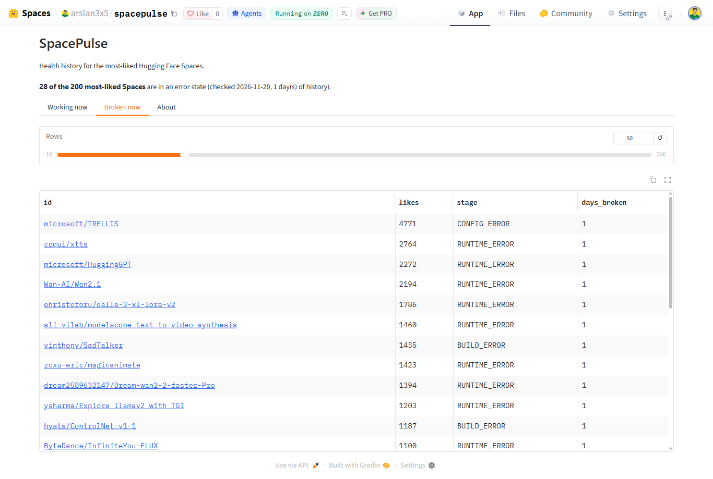

# SpacePulse

Health history for Hugging Face Spaces.

Popular Spaces break, and nobody tracks it. SpacePulse checks the runtime state
of the 200 most-liked Spaces every day and saves it as an open dataset, so you
can see which ones are down and for how many days.

- **Dashboard:** https://huggingface.co/spaces/arslan3x5/spacepulse
- **Dataset (updated daily):** https://huggingface.co/datasets/arslan3x5/spacepulse-history



## What it does

- Records one snapshot per day: running, sleeping, build error, runtime error
- Shows which Spaces work right now, filterable by SDK
- Lists the most-liked broken Spaces and how many days each has been broken
- Detects Spaces that newly broke or recovered between two snapshots

## How it works

```
GitHub Actions (daily)
        |  python -m spacepulse --upload ...
        v
Hugging Face dataset: data/YYYY-MM-DD.csv
        |  read by
        v
Gradio dashboard (Hugging Face Space)
```

The collector runs on GitHub Actions, not on the Space, so snapshots keep
coming even when the free Space is asleep.

## Usage

```
pip install -e .
python -m spacepulse --limit 200
```

This writes `data/<date>.csv` and prints a summary. Add
`--upload user/dataset-name` (with an `HF_TOKEN` environment variable) to also
publish the snapshot to a dataset repo.

## Data format

One CSV per day, one row per Space:

| Column | Meaning |
| --- | --- |
| `date` | Snapshot date (UTC) |
| `id` | Space id, e.g. `org/name` |
| `likes` | Likes at snapshot time |
| `sdk` | `gradio`, `docker`, `static`, ... |
| `stage` | Raw Hugging Face runtime stage, e.g. `RUNNING`, `RUNTIME_ERROR` |
| `hardware` | Hardware the Space runs on |

A stage that fails to load is stored as `ERROR_<ExceptionName>` and treated as
unknown, so a network problem is never counted as a broken Space.

## Limits

- It tracks the most-liked Spaces only, not the whole Hub.
- It measures the runtime state, not whether the Space gives good results.
- Sleeping and paused Spaces are not counted as broken.
- Some broken Spaces may be retired on purpose or replaced by newer versions.

## Development

```
pip install -e ".[dev]"
python -m pytest
```

Tests use fake API objects, so they run without a network connection.

## License

MIT
